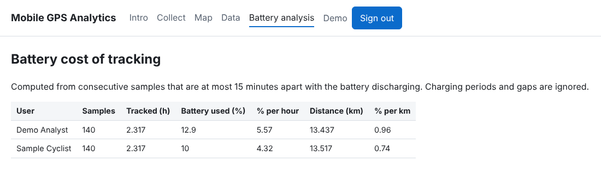
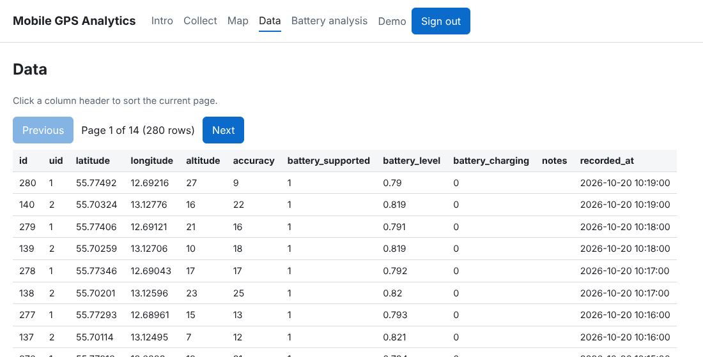

# mobile-gps-analytics

[](https://github.com/aikitpete/mobile-gps-analytics/actions/workflows/ci.yml) [](LICENSE)   

Collect GPS traces from a phone, store them in SQL, look at them on a map, and measure what continuous tracking costs in battery.

Started in 2014/15 as a student project on cycling behaviour in the Öresund region, and later brought up to date: PDO prepared statements, hashed passwords, CSRF protection, role-based access and tests.

<p>
  
  
</p>

*Screenshots use synthetic sample data (two generated tracks), not real people's locations.*

**What it is useful for:** a small, complete reference for collecting location and battery samples from a mobile browser, storing them safely (prepared statements, hashed passwords, CSRF protection, per-role access) and turning them into a measurable number: how much battery continuous tracking costs per hour and per kilometre. It was a student project, so treat it as a compact example rather than a production system.

## What is in the repo

| Path | What it is |
|---|---|
| `packages/backend` | PHP 8 + MySQL web app: collection API, map view, data table, battery analysis |
| `packages/mobile-ios` | Small Objective-C CoreLocation logger used to evaluate native tracking (writes positions to the console) |

## Backend features

- **Collect** – a browser page samples position (Geolocation API) and battery level (Battery Status API, Chromium browsers) at a chosen interval and posts it to the API.
- **Map** – recorded positions per user on an OpenStreetMap/Leaflet map.
- **Data** – paged, sortable table of raw samples; deletion is limited to the `data_admin` role.
- **Battery analysis** – per user: tracked hours, battery used, **% per hour** and **% per km**. Charging periods and gaps longer than 15 minutes are excluded (`src/analysis.php`).
- **Access model** – new accounts get the `usability_analyst` role and only see their own data; `data_analyst` and `data_admin` see everyone's.

## Run it locally

Requirements: PHP 8.1+ with `pdo_mysql`, MySQL or MariaDB.

```bash
cd packages/backend
mysql -e "CREATE DATABASE gps_analytics CHARACTER SET utf8mb4" && mysql gps_analytics < database.sql

export DB_DSN="mysql:host=127.0.0.1;dbname=gps_analytics;charset=utf8mb4"
export DB_USER=gps_app DB_PASS=change-me      # see .env.example

# optional: create an administrator
php bin/create-user.php you@example.com Ada Lovelace data_admin

php -S 127.0.0.1:8080 -t public
```

Open <http://127.0.0.1:8080>. Geolocation needs HTTPS on a phone, so use a tunnel or a TLS-terminating reverse proxy for field tests.

## Tests

```bash
bash packages/backend/tests/run.sh
```

Runs unit tests for the analysis functions and an end-to-end pass (sign up, sign in, collect, list, role checks, CSRF, injection attempt) against PHP's built-in server with a temporary SQLite database. CI runs the same script.

## Layout

```
packages/backend
├─ public/      web root: index.php (pages), api.php (JSON API), css/, js/
├─ src/         bootstrap (config, PDO, session, CSRF), analysis functions, page templates
├─ bin/         create-user.php
├─ tests/       smoke tests and SQLite schema
└─ database.sql MySQL schema
```

## Configuration

All settings come from environment variables (`DB_DSN`, `DB_USER`, `DB_PASS`). Nothing secret is stored in the repository.

MIT licence.
